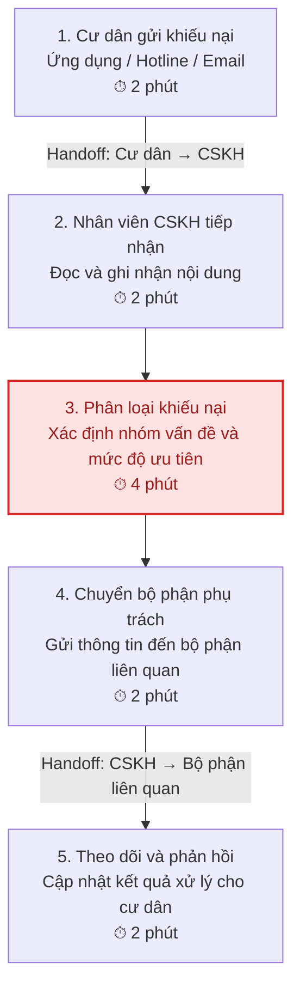
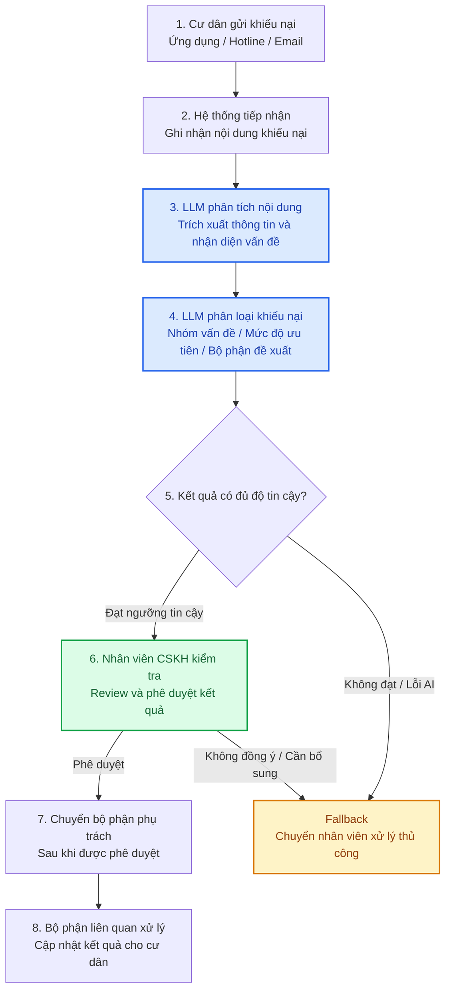

# 02 – DEEP-DIVE REPORT & AI READINESS ASSESSMENT

**Lab 02: AI Product Scoping – Vin Smart Future**  
**Selected Use Case:** AI-Assisted Resident Complaint Classification for Vinhomes

---

# PHASE 3 – DEEP-DIVE

## 3.1. Current-State Workflow Mapping

### A. Current-State Workflow

Quy trình tiếp nhận và xử lý khiếu nại cư dân Vinhomes được mô phỏng qua 5 bước:

### B. Workflow Breakdown

| Step | Activity | Responsible Actor | Estimated Time |
|---|---|---|---:|
| 1 | Gửi khiếu nại qua ứng dụng, hotline hoặc email | Cư dân | 2 phút |
| 2 | Tiếp nhận và ghi nhận nội dung phản ánh | Nhân viên CSKH | 2 phút |
| 3 | Đọc, phân loại và xác định mức độ ưu tiên | Nhân viên CSKH | 4 phút |
| 4 | Chuyển khiếu nại đến bộ phận phụ trách | Nhân viên CSKH | 2 phút |
| 5 | Theo dõi và phản hồi kết quả xử lý | CSKH / Bộ phận liên quan | 2 phút |
| | **Total Processing Time** | | **12 phút/lượt** |

*Note: The processing times are illustrative assumptions for workflow scoping and have not been verified against Vinhomes' actual operational data.*

### C. Bottleneck Identification

**Primary Bottleneck – Step 3: Complaint Classification**

Đây là bước có khả năng gây tắc nghẽn lớn nhất trong quy trình do:

- Nhân viên phải đọc và hiểu nội dung khiếu nại bằng ngôn ngữ tự nhiên.
- Nội dung phản ánh có thể không rõ ràng hoặc chứa nhiều vấn đề cùng lúc.
- Nhân viên phải xác định đúng nhóm vấn đề và bộ phận chịu trách nhiệm.
- Phân loại không chính xác có thể dẫn đến chuyển nhầm bộ phận và kéo dài thời gian xử lý.

Do đó, bước phân loại khiếu nại được xác định là vị trí tiềm năng để ứng dụng AI nhằm hỗ trợ nhân viên CSKH.

### D. Handoff Identification

**Handoff 1: Resident → Customer Service**

Cư dân gửi thông tin khiếu nại thông qua ứng dụng, hotline hoặc email. Nhân viên CSKH tiếp nhận và ghi nhận nội dung.

**Handoff 2: Customer Service → Responsible Department**

Sau khi phân loại, nhân viên CSKH chuyển thông tin khiếu nại đến bộ phận phụ trách như kỹ thuật, vệ sinh, an ninh hoặc quản lý vận hành.

**Handoff 3: Responsible Department → Customer Service / Resident**

Bộ phận phụ trách cập nhật kết quả xử lý để CSKH phản hồi lại cư dân.

### E. Current-State Workflow Summary

Quy trình tiếp nhận và xử lý khiếu nại cư dân Vinhomes trong mô hình đề xuất gồm 5 bước, với tổng thời gian xử lý giả định là **12 phút/lượt**. Trong đó, bước đọc và phân loại khiếu nại là bottleneck chính do phụ thuộc vào thao tác thủ công và khả năng đánh giá nội dung của nhân viên CSKH.

Đây là vị trí tiềm năng để ứng dụng Large Language Model (LLM) nhằm hỗ trợ phân loại nội dung khiếu nại và đề xuất bộ phận tiếp nhận phù hợp.

---

## 3.2. Problem Statement (6-field) & Metrics

### A. Problem Statement

| Field | Nội dung chi tiết |
|---|---|
| **1. Actor / Operator** | Nhân viên chăm sóc khách hàng (CSKH) và nhân viên Ban Quản lý khu đô thị Vinhomes, những người trực tiếp tiếp nhận, phân loại và điều phối khiếu nại của cư dân. |
| **2. Current Workflow** | Cư dân gửi khiếu nại qua ứng dụng, hotline hoặc email. Nhân viên CSKH tiếp nhận, đọc nội dung, xác định nhóm vấn đề, phân loại mức độ ưu tiên và chuyển thông tin đến bộ phận phụ trách. Quy trình hiện tại chủ yếu dựa trên thao tác thủ công và các công cụ tiếp nhận, quản lý phản ánh. |
| **3. Bottleneck** | Bước đọc và phân loại nội dung khiếu nại là bottleneck chính. Nhân viên phải hiểu nội dung ngôn ngữ tự nhiên, xác định nhóm vấn đề và lựa chọn bộ phận xử lý phù hợp. Những phản ánh không rõ ràng hoặc chứa nhiều vấn đề có thể làm tăng thời gian xử lý và nguy cơ phân loại sai. |
| **4. Business Impact** | Việc phân loại và điều phối thủ công có thể làm tăng thời gian xử lý mỗi khiếu nại, tiêu tốn nguồn lực nhân viên CSKH và gây chậm trễ trong quá trình chuyển thông tin đến bộ phận phụ trách. Theo workflow giả định ở mục 3.1, tổng thời gian xử lý là 12 phút/lượt, trong đó bước phân loại mất khoảng 4 phút/lượt. |
| **5. Success Metric** | - Độ chính xác phân loại khiếu nại đạt ít nhất 90%. - Thời gian phân loại giảm từ khoảng 4 phút xuống dưới 1 phút/lượt. - Tỷ lệ khiếu nại được đề xuất đúng bộ phận phụ trách đạt ít nhất 90%. |
| **6. Operational Boundary** | **AI được phép:** Phân tích nội dung khiếu nại, xác định nhóm vấn đề, trích xuất thông tin quan trọng, đề xuất mức độ ưu tiên và bộ phận tiếp nhận.  **AI không được phép:** Tự động đóng khiếu nại, tự đưa ra quyết định xử lý, cam kết thời gian khắc phục hoặc gửi phản hồi chính thức cho cư dân khi chưa được phê duyệt.  **Human-in-the-loop:** Nhân viên CSKH phải kiểm tra và phê duyệt kết quả phân loại, đề xuất điều phối trước khi chuyển đến bộ phận phụ trách. |

### B. Success Metrics

| Metric | Baseline (Current State) | Target (Future State) |
|---|---:|---:|
| Thời gian phân loại khiếu nại | 4 phút/lượt | Dưới 1 phút/lượt |
| Độ chính xác phân loại | Chưa có dữ liệu đo lường | ≥ 90% |
| Độ chính xác đề xuất bộ phận phụ trách | Chưa có dữ liệu đo lường | ≥ 90% |

*Note: The processing time in the baseline is an illustrative estimate derived from the proposed workflow in Section 3.1. Accuracy baselines have not yet been established and require evaluation using labeled complaint data. Target metrics are proposed acceptance criteria for the prototype.*

### C. Problem Statement Summary

Vinhomes cần một giải pháp hỗ trợ nhân viên CSKH phân loại và điều phối khiếu nại cư dân hiệu quả hơn. Quy trình thủ công hiện tại phụ thuộc vào việc nhân viên đọc, hiểu và phân loại nội dung phản ánh, dẫn đến nguy cơ mất thời gian và chuyển nhầm bộ phận phụ trách.

Giải pháp đề xuất ứng dụng Large Language Model (LLM) để phân tích nội dung khiếu nại, nhận diện nhóm vấn đề và đề xuất bộ phận tiếp nhận. Hệ thống hướng đến độ chính xác phân loại tối thiểu 90% và giảm thời gian phân loại xuống dưới 1 phút/lượt, đồng thời duy trì cơ chế nhân viên kiểm tra và phê duyệt trước khi thực hiện điều phối.

---

## 3.3. Future-State Flow & AI Fit

### A. AI-Fit Matrix

**Selected Architecture: LLM Feature**

| Architecture | Applicability | Evaluation |
|---|---|---|
| Rule / State-Machine | Có thể sử dụng để phân loại các trường hợp đơn giản dựa trên từ khóa hoặc quy tắc được xác định trước. Tuy nhiên, khó xử lý các khiếu nại có ngữ cảnh phức tạp, cách diễn đạt đa dạng hoặc nhiều vấn đề trong cùng một nội dung. | Partially Suitable |
| LLM Feature | Có khả năng hiểu ngữ cảnh ngôn ngữ tự nhiên, trích xuất thông tin quan trọng, phân loại nội dung khiếu nại và đề xuất bộ phận phụ trách. | **Selected** |
| Agentic Loop | Có thể thực hiện nhiều bước tự động như phân tích, truy xuất thông tin và điều phối tác vụ. Tuy nhiên, phạm vi bài toán hiện tại chưa yêu cầu AI tự chủ thực hiện nhiều hành động liên tiếp. | Not Necessary |

**Rationale for Selection**

LLM Feature được lựa chọn vì nội dung khiếu nại của cư dân thường được diễn đạt bằng ngôn ngữ tự nhiên, không đồng nhất về cấu trúc và có thể chứa nhiều vấn đề khác nhau. LLM có thể phân tích ngữ cảnh, nhận diện nhóm khiếu nại và đề xuất bộ phận tiếp nhận phù hợp.

So với Rule-based, LLM linh hoạt hơn trong việc hiểu các cách diễn đạt khác nhau. So với Agentic Loop, LLM Feature có phạm vi triển khai đơn giản hơn và phù hợp với yêu cầu hỗ trợ phân loại, không cần trao quyền tự động điều phối hoàn toàn cho AI.

### B. Future-State Workflow

Quy trình đề xuất sau khi tích hợp LLM:

### C. Identification of Key Components

**🔵 AI Step – LLM Processing**

LLM đảm nhiệm các tác vụ:

1. Phân tích nội dung khiếu nại bằng ngôn ngữ tự nhiên.
2. Trích xuất thông tin quan trọng như loại sự cố, vị trí và nội dung phản ánh.
3. Phân loại khiếu nại theo nhóm: điện, nước, vệ sinh, an ninh, tiện ích và các vấn đề khác.
4. Đề xuất mức độ ưu tiên và bộ phận tiếp nhận phù hợp.
5. Trả về kết quả dưới dạng JSON có cấu trúc để hệ thống xử lý tiếp.

**🟢 Human Step – Human-in-the-Loop (HITL)**

Nhân viên CSKH thực hiện:

1. Kiểm tra nội dung khiếu nại và kết quả phân loại của AI.
2. Xác nhận nhóm vấn đề và bộ phận được đề xuất.
3. Chỉnh sửa kết quả nếu AI phân loại chưa chính xác.
4. Phê duyệt trước khi chuyển khiếu nại đến bộ phận phụ trách.

**↩️ Fallback – Error Handling**

Khi LLM gặp lỗi hoặc kết quả không đủ độ tin cậy:

1. Hệ thống không tự động chuyển khiếu nại.
2. Chuyển nội dung sang hàng đợi xử lý thủ công.
3. Nhân viên CSKH trực tiếp đọc và phân loại khiếu nại.
4. Ghi nhận lỗi hoặc trường hợp phân loại không chính xác để cải thiện hệ thống.

### D. Operational Control and Safety

| Control | Implementation |
|---|---|
| AI Confidence | Thiết lập ngưỡng tin cậy để xác định trường hợp cần kiểm tra thủ công. Ngưỡng cụ thể cần được hiệu chỉnh thông qua dữ liệu kiểm thử. |
| Structured Output | Yêu cầu LLM trả về JSON theo schema xác định. |
| Human Approval | Bắt buộc nhân viên CSKH phê duyệt trước khi điều phối. |
| Error Handling | Chuyển sang quy trình thủ công nếu API lỗi hoặc kết quả không hợp lệ. |
| Data Protection | Hạn chế dữ liệu cá nhân không cần thiết trong nội dung gửi đến mô hình. |

**Operational Boundary**

LLM chỉ đóng vai trò hỗ trợ phân tích, phân loại và đề xuất. Hệ thống không được tự động đóng khiếu nại, đưa ra quyết định xử lý cuối cùng hoặc gửi phản hồi chính thức cho cư dân khi chưa có sự phê duyệt của nhân viên có trách nhiệm.

### E. Future-State Workflow Summary

Giải pháp đề xuất sử dụng LLM Feature để hỗ trợ tự động phân tích và phân loại khiếu nại cư dân Vinhomes. Quy trình mới kết hợp khả năng xử lý ngôn ngữ tự nhiên của LLM với cơ chế Human-in-the-Loop nhằm duy trì sự kiểm soát của nhân viên đối với các quyết định vận hành.

Khi mô hình trả về kết quả lỗi, thiếu thông tin hoặc không đủ độ tin cậy, hệ thống sẽ chuyển sang quy trình xử lý thủ công. Cách tiếp cận này giúp tận dụng khả năng của AI nhưng vẫn duy trì tính an toàn, khả năng kiểm soát và trách nhiệm của con người.

---

# PHASE 5 – EVALUATE

## 5.1. AI Readiness Checklist

| # | Tiêu chí đánh giá | Trạng thái | Giải thích |
|---|---|---|---|
| 1 | Có sẵn dữ liệu mẫu/logs sạch để kiểm thử? | ❌ Chưa đạt | Hiện tại prototype mới được kiểm thử bằng 3 tình huống giả lập. Chưa có tập dữ liệu khiếu nại thực tế đã được làm sạch và gán nhãn để đánh giá hiệu suất phân loại. |
| 2 | Rủi ro khi AI đưa ra kết quả sai có nằm trong tầm kiểm soát? | ✅ Đạt ở mức thiết kế ban đầu | Prototype đã thiết lập Human-in-the-loop. AI chỉ đề xuất phân loại và bộ phận phụ trách; mọi kết quả đều yêu cầu nhân viên CSKH kiểm tra và phê duyệt. |
| 3 | Các bên liên quan đã sẵn sàng thay đổi quy trình làm việc cũ? | ⚠️ Chưa xác định | Chưa có khảo sát hoặc xác nhận từ nhân viên CSKH và Ban Quản lý về mức độ sẵn sàng tiếp nhận và sử dụng công cụ AI. |

## 5.2. Quyết định cuối cùng của Ban Giám Đốc Vin Smart Future

- [ ] **GO** – Bắt đầu xây dựng Prototype.
- [x] **NOT YET** – Cần tích lũy thêm dữ liệu và xác lập baseline.
- [ ] **NO-GO** – Không khả thi hoặc Rule-based tốt hơn.

## 5.3. Justification – Lý giải quyết định

Dựa trên kết quả đánh giá mức độ sẵn sàng, dự án AI hỗ trợ phân loại khiếu nại cư dân tại Vinhomes được đề xuất ở trạng thái **NOT YET**.

Về mặt kỹ thuật, prototype sử dụng Gemini 3.5 Flash kết hợp Python để phân tích nội dung khiếu nại và tạo đầu ra JSON có cấu trúc. Kết quả kiểm thử ban đầu vượt qua 3/3 tình huống giả lập (100% test assertion pass rate), bao gồm khiếu nại thông thường, Prompt Injection và khiếu nại thiếu thông tin. Đặc biệt, mô hình duy trì yêu cầu Human-in-the-loop và không thực hiện các hành động xử lý khiếu nại ngoài phạm vi được cho phép.

Tuy nhiên, kết quả kiểm thử hiện tại mới phản ánh khả năng đáp ứng các tình huống giả lập, chưa đủ cơ sở để khẳng định độ chính xác và độ tin cậy khi triển khai trong môi trường thực tế. Một số kết quả, chẳng hạn việc đề xuất mức ưu tiên cao đối với khiếu nại thiếu thông tin, cho thấy prompt và tiêu chí đánh giá mức độ ưu tiên vẫn cần được cải thiện. Dự án vẫn cần tập dữ liệu khiếu nại thực tế đã được làm sạch và gán nhãn, đồng thời cần xác lập baseline để so sánh hiệu quả giữa quy trình phân loại thủ công, phương pháp Rule-based và giải pháp sử dụng LLM.

Bên cạnh đó, mức độ sẵn sàng của nhân viên CSKH và các bộ phận liên quan chưa được xác minh. Việc triển khai cũng cần xem xét chi phí API, chi phí tích hợp hệ thống, bảo mật dữ liệu cư dân và chi phí giám sát kết quả AI.

**Các điều kiện cần hoàn thiện trước khi chuyển sang GO:**

1. Thu thập và chuẩn hóa dữ liệu khiếu nại thực tế, có ẩn danh thông tin cá nhân.
2. Xây dựng tập dữ liệu kiểm thử có nhãn để đo lường độ chính xác phân loại và khả năng đề xuất bộ phận phụ trách.
3. Thiết lập baseline giữa quy trình thủ công, Rule-based và LLM.
4. Thử nghiệm với nhân viên CSKH trong phạm vi nhỏ, duy trì cơ chế Human-in-the-loop.
5. Đánh giá chi phí vận hành, bảo mật và khả năng tích hợp với quy trình hiện tại.

**Kết luận:** NOT YET không đồng nghĩa với việc dự án AI không khả thi. Đây là quyết định trì hoãn triển khai thực tế để bổ sung dữ liệu, xác lập baseline và kiểm chứng hiệu quả vận hành. Sau khi đáp ứng các điều kiện trên, dự án có thể được xem xét chuyển sang GO với phạm vi triển khai giới hạn.
